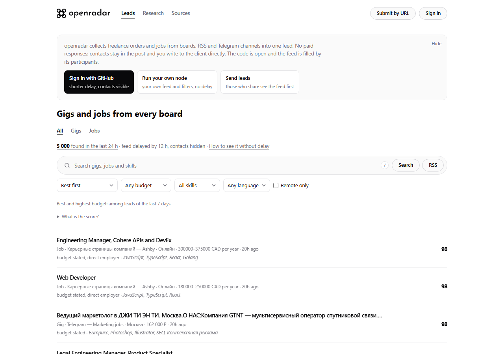

# openradar

<p align="right"><b>English</b> · <a href="README.ru.md">Русский</a></p>

<p align="center">
  <picture>
    <source media="(prefers-color-scheme: dark)" srcset="assets/logo-white.png">
    <source media="(prefers-color-scheme: light)" srcset="assets/logo-black.png">
    
  </picture>
</p>

<p align="center">
  <a href="https://openradar.fun"></a>
  <a href="docs/stories.json"></a>
  <a href="LICENSE"></a>
  <a href="docs/PROTOCOL.md"></a>
</p>

openradar is an open base of job vacancies and freelance orders. Parsers, nodes and people add posts from boards, RSS feeds, Telegram channels and email alerts; the hub merges duplicates and keeps one clean feed.

Job seekers should not have to pay for subscriptions to parsers or for responding to a vacancy. openradar has no paid tier: the contacts are in the post, and you write to the client directly. Anyone can run their own copy.

**Live hub:** [openradar.fun](https://openradar.fun) · **Want to help?** Start with [CONTRIBUTING.md](CONTRIBUTING.md): one board, one adapter, one pull request.

<p align="center">
  <a href="https://openradar.fun"></a>
</p>

## What it does

- **One feed of every trade.** FL.ru, Kwork, Freelancehunt, Habr Career, hh.ru, Работа России, We Work Remotely, Jobicy, RemoteOK and Telegram channels (public ones as they are, private ones and chats through your own account): development, design, video, writing, ads, sales and more. A post seen on two boards is one lead.
- **Search, filters and a rating.** Budget from, skill, remote only, language. The feed opens with the best recent leads first (rating, fading with age); newest or highest budget are one click away. Each lead gets a 0-100 rating from its pay, skills, detail and a direct contact. A vacancy whose pay is far below the usual for its role shows «check the salary» instead of the number.
- **Browser extension.** Sign in with GitHub once, then add a vacancy or an order from any site in one click; it also shows what similar work usually pays and whether the pay on the page is below, within or above it.
- **Votes and submissions.** Signed-in users mark leads as useful, junk, scam or closed, and add posts by link.
- **Market research.** [openradar.fun/research](https://openradar.fun/research): pay in vacancies and order budgets by role, grade, language, city and skill, with medians, quartiles and sample sizes. Monthly reports are frozen so they can be cited; the data is open under CC BY 4.0 (CSV and JSON). How it is counted: [methodology](https://openradar.fun/research/methodology).
- **RSS for any query**, an HTTP API and an MCP server over the same feed.
- **Your own node.** Run it at home or on a server, connect your sources, filters and notifications (Telegram, webhook). Nothing leaves the node unless you share a source.

## The network

Nodes and parsers can send their posts to the shared hub. Every post is signed with the participant's key. The hub merges the same post seen in different places, credits whoever saw it first, and lowers the weight of junk and scam by the votes and the rating of the participants who reported it.

People who send leads see the feed earlier:

| Tier | How | Delay | Contacts |
| --- | --- | --- | --- |
| Guest | not signed in | 12 h | hidden |
| Member | GitHub sign-in, or rating 1+ | 3 h | shown |
| Active | rating 10+ over 30 days | 30 min | shown |
| Core | rating 50+, or moderator | none | shown |

Rating comes from confirmed leads you saw first (×1.5 for private channels and for a 6-hour exclusive), confirmations and signals that matched the outcome; leads hidden as junk or scam cost points. Details: [docs/PROTOCOL.md](docs/PROTOCOL.md).

## Quick start

Node.js 22.19+ and pnpm 11+:

```bash
git clone https://github.com/MikhailSagalaev/openradar.git
cd openradar
pnpm install
pnpm dev serve
```

`serve` prints a one-off admin token. Open `http://127.0.0.1:8787`, sign in with it, go to **Источники** → **Каталог площадок** and connect boards one by one or all at once (**Подключить все**): they are polled right away and the first leads appear within seconds.

Without `DATABASE_URL` the node keeps everything in memory. For a persistent node, use PostgreSQL 17 through Docker:

```bash
pnpm init:env           # writes .env with fresh random secrets
docker compose run --rm radar migrate
docker compose up -d
```

`pnpm init:env` never overwrites an existing `.env`. If you copy `.env.example` by hand instead, replace its secrets: `docker compose` refuses to start with the example ones.

## Connecting a parser

Any script (a Telethon reader for private channels, a Playwright scraper, a cron job) can send posts to a node:

```bash
pnpm dev source add --kind webhook --title "My parser"   # prints the source id and token
python my_parser.py | pnpm dev push --source <id>        # NDJSON, one post per line
# or over HTTP: POST /api/v2/ingest/<id> with the header x-radar-token
```

Or straight to the hub with the Python SDK (standard library only, Telethon and Pyrogram helpers included):

```bash
pip install "git+https://github.com/MikhailSagalaev/openradar#subdirectory=sdk/python"
```

```python
import os
from openradar import HubClient, Key

hub = HubClient("https://openradar.fun", Key.from_string(os.environ["RADAR_KEY"]))
hub.observe([{"source": {"platform": "telegram", "channel": "-1001234567890", "visibility": "private", "message_id": "48213"},
              "text": "Ищем React-разработчика..."}])
```

`RADAR_KEY` is your participant key (`pnpm dev key`); your rating is bound to it. The TypeScript package exports the same `HubClient` and `NodeClient`.

## Documentation

| Document | Contents |
| --- | --- |
| [GETTING_STARTED.md](docs/GETTING_STARTED.md) | Scenarios: reading the hub, running a node, a server, a parser, sharing with the hub |
| [PROTOCOL.md](docs/PROTOCOL.md) | radar/2: posts, signatures, merging, tiers, rating, moderation |
| [ARCHITECTURE.md](docs/ARCHITECTURE.md) | The node pipeline, the score, the data model, HTTP routes |
| [PLUGINS.md](docs/PLUGINS.md) | Writing a source or sink adapter |
| [EXTENSION.md](docs/EXTENSION.md) | The browser extension and the market estimate |
| [BACKUP_AND_RESTORE.md](docs/BACKUP_AND_RESTORE.md) | Backups |
| [sdk/python](sdk/python/README.md) | Python SDK |

## Contributing

New boards are the most useful contribution: one adapter, one fixture, one test; `pnpm new:connector` writes the skeleton. See [CONTRIBUTING.md](CONTRIBUTING.md) and the [code of conduct](CODE_OF_CONDUCT.md). Report vulnerabilities privately: [SECURITY.md](SECURITY.md).

## License

AGPL-3.0. See [LICENSE](LICENSE).
