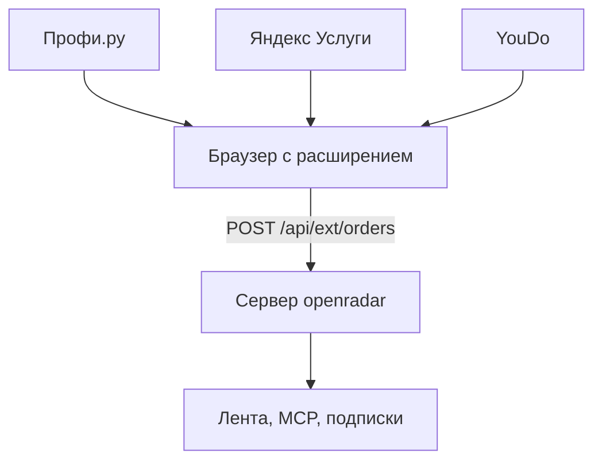

# Заказы с Профи.ру, Яндекс Услуг и YouDo

Заказы — основной поток openradar. Эти три площадки закрывают заказы входом или robots.txt, поэтому читаем их только через аккаунты, которые завёл владелец хаба. Решение принято 5 ноября 2026. Оно нарушает порядок из [SOURCES_ROBOTS.md](SOURCES_ROBOTS.md) сознательно: условия площадок могут запрещать автосбор, а аккаунты могут заблокировать.

## Как это работает

Сервер openradar на эти площадки не ходит. YouDo отвечает серверу проверкой на бота, а Профи и Яндекс показывают заказы только после входа. Заказы читает обычный браузер с расширением и шлёт их на сервер.

1. По таймеру, не чаще раза в 15 минут, расширение открывает площадки, включённые в попапе, в фоновой вкладке. Фильтры выбираются там же. Новая площадка добавляется записью в `extension/boards.js`, разбором в `collector.js` и строкой в `COLLECTOR_PLATFORMS` на сервере.
2. Читает новые заказы, как обычная страница, и запоминает уже виденные.
3. Шлёт их на сервер без заказчика и улицы.
4. Сервер чистит контакты, убирает дубли, определяет тип, ставит рейтинг и сохраняет.

Браузер должен быть включён, и в нём должен быть выполнен вход. Если сессия истекла или площадка показала проверку, сбор этой площадки молча останавливается, пока человек не войдёт снова.

## Что определяет охват

| Площадка | Охват | Как расширить |
|---|---|---|
| YouDo | вся лента | не нужно: одного браузера хватает |
| Яндекс Услуги | удалённые заказы и регион аккаунта | другой регион в настройках или второй аккаунт |
| Профи.ру | анкета аккаунта | больше специальностей в анкете или новый аккаунт |

## Куда развивать

1. **Сборщик-компьютер.** Отдельная всегда включённая машина с настоящим Chrome. Один профиль Chrome на аккаунт, у каждого своё расширение. Сервер с безголовым браузером не подходит: это уже обход проверки на бота.
2. **Письма.** Уведомления площадок в отдельный ящик, сервер читает их через IMAP. Работает без браузера и страхует сборщик.
3. **Участники сети.** Фрилансеры уже сидят на этих площадках со своими городами и профессиями. Если сборщик сможет включить любой участник, охват будет расти сам, без наших аккаунтов. Для этого нужны согласие участника, проверка подлинности заказов (совпадение у двух участников, репутация) и баллы за вклад. Сейчас приём открыт только администратору, чтобы никто не подделал заказ под именем площадки.

## Правила

- Вход делает человек. Пароли и коды из SMS в код и в репозиторий не попадают.
- Защиту от ботов не обходим: ни подмены TLS, ни чужих подписей приложений, ни решения проверок.
- В карточке только задача, бюджет, город, категория и ссылка. Имена и телефоны заказчиков не храним.
- Частота низкая. Отклики не отправляем.

## Что есть на GitHub

Проверено 5 ноября 2026. Лицензии почти нигде нет, поэтому код не копируем, берём только факты об адресах и разметке. Селекторы и запросы могли устареть.

| Репозиторий | Обновлён | Площадки | Способ |
|---|---|---|---|
| [safonovich/lovec-sjomka](https://github.com/safonovich/lovec-sjomka) | 2026-11 | YouDo, Профи | куки и браузер, запуск в GitHub Actions |
| [ajdevy/profi_ru_bot](https://github.com/ajdevy/profi_ru_bot) | 2026-10 | Профи | GraphQL доски, ручной вход в браузере |
| [Asmadey/freelance-monitoring-with-respond-bot](https://github.com/Asmadey/freelance-monitoring-with-respond-bot) | 2026-09 | Профи, YouDo, Kwork, FL.ru, Upwork | мобильные API, повтор подписей |
| [ronkin32222/lead-harvester-clean](https://github.com/ronkin32222/lead-harvester-clean) | 2026-09 | Профи, Яндекс, Kwork, FL.ru | письма с площадок, IMAP |
| [aurusxd/telegram-freelance-bot](https://github.com/aurusxd/telegram-freelance-bot) | 2026-08 | Яндекс, Kwork, FL.ru | Playwright с сохранённой сессией |
| [revolexGeek/profi-notifications](https://github.com/revolexGeek/profi-notifications) | 2026-07 | Профи | GraphQL, куки от отдельного сервиса |
| [Asmadey/profi-ru-parser-zakazov](https://github.com/Asmadey/profi-ru-parser-zakazov) | 2026-07 | Профи | мобильный GraphQL |

## Что известно о площадках

**Профи.ру.** Проверено под аккаунтом 5 ноября 2026. Лента `profi.ru/backoffice/n.php`, карточки `a[data-testid$="_order-snippet"]`, подгружаются при прокрутке: в ленте аккаунта было 67 заказов. На карточке заголовок, бюджет, условия, город, признак «Дистанционно» и возраст заказа. Регион и специальности берутся из анкеты аккаунта, поэтому широта охвата зависит от анкет. Поиск в ленте работает только с настоящей клавиатуры, скриптом его не запустить.

**Яндекс Услуги.** Проверено под аккаунтом 5 ноября 2026, новое название «Яндекс Исполнители». Лента `uslugi.yandex.ru/cab/orders?type=new`, 10 заказов на страницу, листается кнопкой «Далее». Рубрика задаётся в адресе (`rubric=/komp_utery-i-it/sajty-pod-kluc`), параметр `region` страница игнорирует: город берётся из настроек аккаунта. Карточка `/order/<uuid>` несёт в `__PRELOADED_STATE__` описание, дату, цену и рубрики. Там же имя и часть телефона заказчика: их не читаем. Кнопку «Показать номер» сборщик не нажимает.

**YouDo.** Проверено в браузере 5 ноября 2026, вход не нужен: открыто около 7 000 заданий. С сервера и из curl отвечает проверка на бота, поэтому читаем только из браузера. Лента: `POST /api/tasks/tasks/`, 50 заданий на страницу, новые сверху. Фильтры: `lat`, `lng`, `radius` (Санкт-Петербург 30 км: 1 902 задания), `categories` по коду (`virtualassistant`: 753), `onlyVirtual` (удалённые: 1 315), `page`. Карточка `/t<id>` несёт в `__NEXT_DATA__` описание, дату создания, бюджет, подкатегорию и `isVacancy`. В `robots.txt` страницы заданий закрыты для всех роботов.

Сборщик берёт только новые задания, не больше 60 за обход, с паузой 1,5 с. Заказчика и улицу не сохраняем, только город.

## План

Сделано: сборщик в расширении 0.15.0 и приём `POST /api/ext/orders`. Разбор проверен на живых страницах всех трёх площадок. Сквозной прогон в настоящем браузере с тестовым сервером: 60 заказов YouDo дошли порциями по 8. Фильтры берутся со страниц самих площадок: `categoriesTree` и `cities` у YouDo, `rubrics.occupations` у Яндекса. У Профи фильтров нет, всё задаётся анкетой.

1. **Письма (IMAP).** В каждом аккаунте включаются уведомления о заказах на отдельный ящик. У openradar уже есть источник `imap`. Нужны образцы настоящих писем, чтобы написать разбор. Защиту это не затрагивает, но в письмах только заказы, подходящие под настройки аккаунта.
2. **Браузерный сборщик.** Расширение в браузере с открытыми аккаунтами проходит по спискам городов и специальностей и шлёт заказы на `/api/ext/orders`. Принимает только администратор из `RADAR_ADMIN_GITHUB`. Работает для всех трёх площадок, YouDo только так. Если площадка просит вход или проверку, заказы не находятся, и нужен человек.
3. **Профи через GraphQL на сервере.** Необязательно: быстрее, но зависит от заголовков iOS-приложения и ломается с его обновлениями.

## Что нужно от владельца

- Аккаунты на площадках и отдельный почтовый ящик с включёнными уведомлениями.
- Вход в аккаунты в браузере, где будет работать сборщик.
- Список городов и специальностей на старте.
